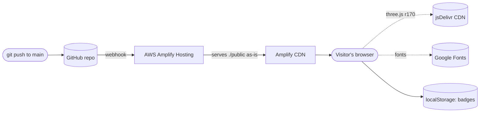

<div align="center">

# `dheeraj.model --load`

### A portfolio you don't scroll. You break it open.

**Dheeraj Reddy Karra** · Data Science and AI · Automation Tester turned AI-native engineer

[](https://main.d20iokpmvk0ua7.amplifyapp.com/)
&nbsp;
[](https://aws.amazon.com/amplify/)
&nbsp;
[](https://threejs.org/)


</div>

---

## The idea

Most portfolios are a list. This one is a **model**.

The home screen is a glass globe with a glowing core: a literal model of everything I know. Each region of it is a part of my background. Click a region and it **breaks**; the shards fly apart and you travel inside, into a scene built just for that topic. Every scene is interactive, and most of them are small games or live simulations rather than slides.

> Break the model. Fix it. Explore it. Find all 15 badges.

---

## Take the tour

| Region | What you'll find inside |
|---|---|
| **Education** | A globe that splits into **Master's** (a live 2-8-8-1 neural network you train in the browser, with its decision boundary and loss curve) and **Bachelor's** (BFS, DFS and Dijkstra animated on a graph you can re-run). |
| **AI agents** | A command centre: a prompt crystal, five agent tiles, three audit gates and a streaming pipeline log. Send a hallucination through the pipeline, or **play the audit gate yourself** and reject the bad packets. A confusion matrix scores you. |
| **Projects** | A globe that splits into **Kalshi** (a trading-system architecture, rebuilt as a *simulator*) and **shorts-engine** (a six-agent, proof-first video pipeline). |
| **Testing** | A holographic test wall with a scan beam, the **Selenium · Cypress · Playwright · Postman** zones, a JIRA board and a regression run that turns red cells green. |
| **Skills and certifications** | A globe that splits into a **skill atom** (41 skills, each on its own orbit) and a **certifications** scene of four floating islands you can spin. |
| **Hobby** | Gaming, as six glass-sphere game objects you can shoot (Valorant, CS2, Rocket League, Overwatch 2, GTA V, Rainbow Six) and three rigs you can power up: a gaming PC, a PS5 and a Meta Quest 3S. |

### Things to try

| Do this | Get this |
|---|---|
| Click a region of the home globe | The model breaks and you fly into that scene |
| Press <kbd>Ctrl</kbd> + <kbd>K</kbd> | A command palette: jump anywhere, run tools, open links |
| Press <kbd>~</kbd> | A tiny terminal (`help`, `ls`, `cat`, `enter`, `break`, `heal`, `git`, `test`, `badges`) |
| Click **Model card** in the header (or open `#about`, `#superpowers`, `#projects`) | A holographic card that assembles from pixel particles. Hover to lift it and let it float, or press *Read as text* for About me, Superpowers and Projects as plain text |
| Click **Built on AWS** in the header (or open `#aws`) | A full-screen 3D deploy pipeline: a commit goes from GitHub to AWS Amplify Hosting to the CDN to the live page |
| Run the **self-test suite** | Twelve real checks (links, accessibility names, contrast, WebGL, load time) executed live in *your* browser |
| Open **Career as a git log** | My timeline as commits. Click one to check it out and watch the model rewind to what existed then |
| Make a **fault-injector card** | A shareable PNG, drawn on your device and never uploaded |
| Record a **6-second clip** | The globe breaking, saved as a video, locally |
| Hunt the **explorer badges** | 15 badges, each with a clue. Collect them all for a surprise |

---

## Explorer badges

The badge system tracks what **you**, the visitor, have discovered. It is stored only in your browser (`localStorage`), never sent anywhere. Locked badges come with a clue, gentle hints appear if you linger, and finishing all 15 triggers a celebration.

<details>
<summary>The 15 badges (spoilers)</summary>

| Badge | How to earn it |
|---|---|
| First fault | Break a region of the home globe |
| Trainer | Train the neural network in Master's |
| Pathfinder | Run a graph algorithm in Bachelor's |
| Gatekeeper | Reject a hallucination in AI agents |
| Regression master | Let a full Testing run finish |
| Sharpshooter | Shoot all six games in Hobby |
| Two for two | Open both Kalshi and shorts-engine |
| QA on QA | Run the self-test suite |
| Collector | Make a fault-injector card |
| Director | Record a clip |
| Time traveller | Check out a commit in the git log |
| Old school | A famous 1986 cheat code |
| Hired | `sudo hire dheeraj` in the terminal |
| Hacker | Open the terminal |
| Completionist | Visit every region of the home globe |

</details>

---

## How it works



- **Plain static files.** No framework, no bundler, no `package.json`. Native ES modules and an import map load [three.js](https://threejs.org/) straight from a CDN.
- **~2,500 lines** of hand-written JavaScript across `public/*.js`, plus one HTML file with all the styling.
- **Rendering:** physically based materials, an environment map for the glass, bloom and a chromatic-aberration pass, and a custom scene-transition layer.
- **Scenes are lazy.** Each scene is built the first time you need it and quietly warmed up afterwards, so the intro starts immediately.
- **Private by design.** No analytics, no cookies, no tracking, no uploads. Everything runs on your device.

### Project layout

```
public/
├── index.html      markup, styles, the import map
├── main.js         renderer, the home globe, scene manager, transitions
├── common.js       the six regions, shared helpers, 3D logo extrusion
├── scenes5.js      globe factory + Education / Projects / Skills globes, Master's, Bachelor's
├── scenes1.js      AI agents command centre
├── scenes2.js      Testing wall
├── scenes6.js      Kalshi and shorts-engine
├── scenes7.js      Skill atom
├── scenes9.js      Certification islands
├── scenes10.js     Hobby
├── ui.js           badges, command palette, terminal
├── tools.js        git log, self-test suite, card maker, clip recorder
├── ovl.js          shared behaviour of the full-screen overlays (focus trap, Esc, pause the globe)
├── story.js        the model card overlay (particle assemble and dissolve, hover float)
├── deploy.js       the Built on AWS deploy pipeline overlay
├── compass.js      the navigation globe
├── fxtext.js       typed text, cursor, icons
├── icons.json      brand icon paths for the 3D logos
└── logos/          optional logo overrides
amplify.yml         tells Amplify to publish ./public with no build
```

---

## Run it locally

No install step. Serve the `public/` folder with any static server:

```bash
npx http-server public -p 3000 -c-1
# then open http://localhost:3000
```

Handy URL parameters:

| Parameter | Effect |
|---|---|
| `?nobook=1` | Skip the boot text |
| `?scene=N` | Jump straight to scene `N` (0 to 11) |

---

## Deploy it yourself

1. Push this repo to GitHub.
2. In **AWS Amplify Hosting**, create an app from the repo and branch `main`.
3. Amplify reads [`amplify.yml`](./amplify.yml): there is nothing to build, and it publishes the `public/` folder.
4. Every push to `main` redeploys automatically.

---

## A note on honesty

The Kalshi scene is a **reconstruction**. The original trading code was lost, so the simulator on this site rebuilds the *architecture* of the system. **Every number it shows is simulated** and is labelled that way in the scene. Nothing on this site presents simulated results as real performance.

---

## Built for the AWS Student Builder Challenge

| Rubric item | Where to look |
|---|---|
| **Creativity and memorability** | The breakable globe, twelve interactive scenes, the badge hunt, the connection-style transitions |
| **Working AWS implementation** | Hosted on **AWS Amplify Hosting** with CI/CD from GitHub (`git push` deploys) |
| **Communication quality** | The Builder Center write-up, plus the live site's own copy and labels |
| **Completeness and usability** | Keyboard access (<kbd>Ctrl</kbd>+<kbd>K</kbd>, terminal), a built-in self-test, reduced-motion support |

---

<div align="center">

**Dheeraj Reddy Karra**
M.S. Data Science and AI, University of Central Missouri (expected 05/2027) · B.S. Computer Science, cum laude

[GitHub](https://github.com/dheerukarra) · [LinkedIn](https://www.linkedin.com/in/dheeraj-reddy-karra) · [Email](mailto:dheerajreddy.karra@gmail.com)

*Break the model. Then hire the person who built it.*

</div>
